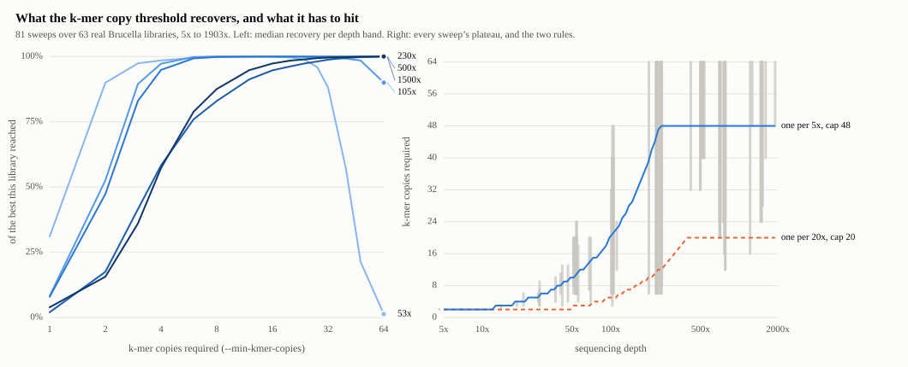

# The k-mer copy threshold

Before MASH sketches a read set it drops every k-mer seen fewer than *m* times, to throw away the
ones that exist only because of a sequencing error. Ask too little and the errors crowd the sketch;
ask too much of a shallow library and the real k-mers go out with them. `--min-kmer-copies` sets *m*
by hand; left alone, BrucellaID derives it from the depth of the sample.

**The rule, since 2.1.0: one more required copy per 5x of estimated coverage, never below 2 and never
above 48.** So a 20x library is sketched at 4, a 70x library at 14, and anything past 240x at the ceiling
of 48. The coverage is estimated from the number of bases in the files against a 3.3 Mb genome, and both
the value used and the coverage it came from are reported, in `brucellaid.json` and in the quality
assurance report.

This page is how that derivation was arrived at, because an earlier one was wrong in a way worth
recording.

## What it replaced

The [validation suite](Validation-suite) reports *B. suis* SRR8550484 as the before-and-after picture
of the first fix: at ~69x a fixed threshold of 2 left it 422 of 1000 hashes at distance 0.0248, and
deriving the threshold from the coverage gave the same library 775 hashes at 0.0065.

That remaining 0.0065 was **not** real distance, and the threshold has since been re-derived because of
it. One more copy per 20x was about three times too cautious in the middle of the depth range, so a
library of a few dozen x was measured with a sketch half full of error k-mers. The rule is now one more
copy per **5x**, floored at 2 and capped at 48, and the same library against the same reference gives 989
of 1000 hashes at 0.00026 instead of 775 at 0.0065.

## How it was set

  <picture>
    <source media="(prefers-color-scheme: dark)" srcset="https://raw.githubusercontent.com/duceppemo/BrucellaID/main/assets/kmer_threshold_dark.svg">
    
  </picture>

**81 sweeps over 63 real libraries, 5x to 1903x.** Three of them are tutorial libraries strided down to
each depth, which separates depth from library quality in a way that comparing two libraries cannot; the
other 60 are public ENA runs stratified across the depth range, because the tutorial libraries stop at 70x
and the median public *Brucella* run is 141x. Every measurement is in
[`scripts/kmer_threshold_sweep.tsv`](https://github.com/duceppemo/BrucellaID/blob/main/scripts/kmer_threshold_sweep.tsv)
and `scripts/make_kmer_figure.py` draws the figure from it.

The left panel is why no single number works. A 53x library peaks between 6 and 20 copies and is down to
**1%** of its own best by 64; a 500x library is still climbing at 20 and only arrives at 40. Ask too
little and error k-mers crowd the sketch; ask too much of a shallow library and the real k-mers go with
them.

The right panel is what a rule has to hit: each sweep's **plateau**, meaning every threshold within 1% of
that sweep's best, drawn as a span at its depth. One copy per 5x capped at 48 lands inside the span for
**80 of the 81**; one copy per 20x capped at 20 lands inside for 26, and runs along the bottom of the
figure from about 40x upward. Per 4x and per 6x both miss more often than per 5x, and caps of 24, 32 and
40 all miss more often than 48, so neither number sits on a flat surface.

The one sweep the rule misses is `SRR24420453`, which is not a *Brucella* library: at a nominal 1482x it
never shares more than 396 of 1000 hashes with anything, its best distance is 0.027, and its recovery
peaks at 20 copies and then falls — a minority *Brucella* population being filtered out along with the
errors. Its distance means nothing at any threshold, and the shared-hash count and the loose-match note
both say so.

## What this does not establish

* **Simulated reads cannot settle any of this**, which is worth saying because an earlier derivation
  rested on them: with uniform error and no duplicates their plateau runs 3-20 at every depth above 50x,
  so they cannot tell one candidate from another.
* **One genus, one platform.** All 63 libraries are *Brucella* and all are paired Illumina. Nothing here
  says what the rule should be for a different genome size — the coverage estimate assumes 3.3 Mb — or for
  a long-read library, whose error profile is not the one these curves were drawn from.
* **The rule is fitted to the data it is scored on.** The 81 curves chose per-5x and the cap of 48, and the
  same 81 curves are what "80 of 81 inside the plateau" counts. There is no held-out set of libraries, so
  that figure measures fit, not prediction. The neighbouring candidates missing more often (per 4x, per 6x,
  caps of 24, 32 and 40) is the evidence that it is not merely overfitted to noise.
* **The plateau is not the only thing that matters.** It is defined on recovery against the reference each
  library already matches, so it says nothing about whether a threshold makes the *wrong* reference closer.
  That question is answered separately, by the species calls in
  [Validation at scale](Validation-at-scale), which did not change when the rule did.
